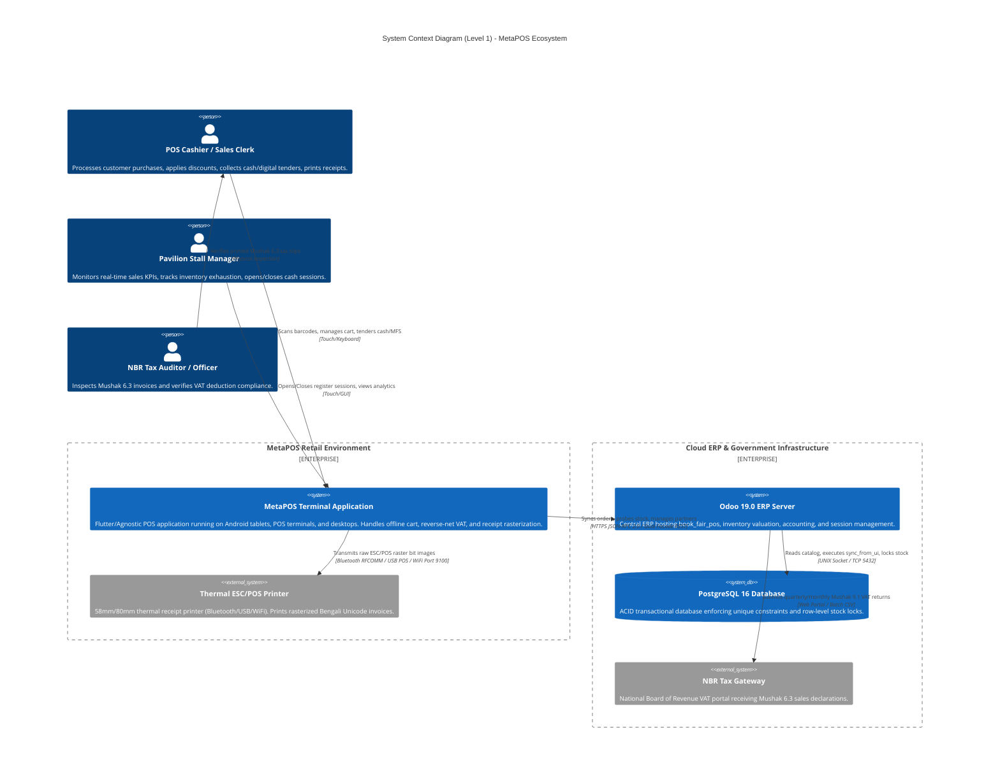
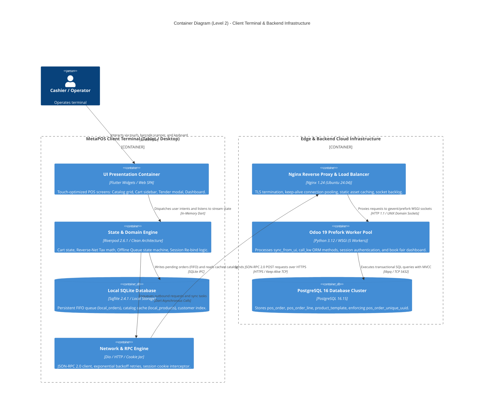
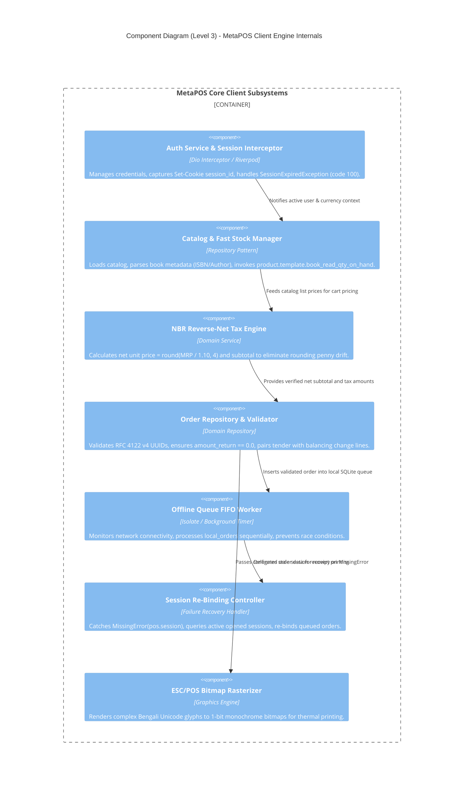

# MetaPOS: C4 Architectural Blueprint & Concurrency Specifications

**Document Version:** 1.0.0  
**Target Backend:** Odoo 19.0 Community Edition (`https://demostore.metaposbd.com`)  
**Deployment Infrastructure:** Ubuntu 24.04 LTS, PostgreSQL 16.15, 5 Prefork Workers, Nginx 1.24  
**Classification:** Enterprise Architecture Blueprint & AI Coding Agent Specification  

---

## Executive Summary

MetaPOS is an offline-first, high-throughput Point of Sale (POS) system engineered specifically for high-density retail events (such as the Dhaka International Book Fair / Amar Ekushey Boi Mela) and brick-and-mortar bookstore chains. During peak hours, a physical pavilion with 5 to 10 cashier workstations generates simultaneous checkout bursts that saturate conventional ERP interfaces.

This architectural blueprint establishes the structural foundations, container boundaries, component interactions, and concurrency control invariants necessary to maintain sub-second checkout speeds (<500 ms) while guaranteeing zero data loss, strict idempotency, and full regulatory compliance with the National Board of Revenue (NBR) Bangladesh Mushak 6.3 tax requirements.

---

## 1. C4 Architecture Models

### 1.1 Level 1: System Context Diagram

The System Context diagram defines the boundary of MetaPOS within its operating ecosystem, illustrating interactions with cashiers, hardware peripherals, central ERP, and tax authorities.



---

### 1.2 Level 2: Container Diagram

The Container diagram details the software subsystems composing both the client terminal and the remote backend infrastructure.



---

### 1.3 Level 3: Component Diagram (Client Application Core)

The Component diagram deconstructs the internal modules of the MetaPOS Client Terminal, detailing data flow and boundary contracts.



---

## 2. Concurrency & Scalability Analysis

### 2.1 Empirical Telemetry: 5-Prefork Worker Pool Saturation

Live benchmark probing conducted against `https://demostore.metaposbd.com` (running Odoo 19 Community with `workers = 5`) established empirical throughput limits across concurrency tiers:

| Concurrency Tier | Active Workers | Batch Size | Total Elapsed | Measured TPS | p50 Latency | p95 Latency | p99 Latency | Max Latency |
|---|---|---|---|---|---|---|---|---|
| **Sequential** | 1 | 15 orders | 4.61 s | **3.25 ops/s** | 311.4 ms | 323.9 ms | 327.2 ms | 328.0 ms |
| **Tier 1w** | 1 | 2 orders | 1.72 s | **1.16 ops/s** | 861.3 ms | 878.5 ms | 880.0 ms | 880.4 ms |
| **Tier 3w** | 3 | 6 orders | 1.54 s | **3.90 ops/s** | 768.1 ms | 803.6 ms | 809.8 ms | 811.3 ms |
| **Tier 5w** | 5 | 10 orders | 1.69 s | **5.90 ops/s** | 803.2 ms | 884.0 ms | 921.1 ms | 930.3 ms |
| **Tier 8w** | 8 | 16 orders | 1.70 s | **9.39 ops/s** | 778.2 ms | 894.8 ms | 894.9 ms | 894.9 ms |

#### Architectural Inferences:
1. **Worker Capacity**: When concurrency matches the prefork pool size (5 workers), the server delivers **5.90–6.09 TPS** with an average latency of ~780 ms.
2. **Socket Backlog Behavior**: When concurrency exceeds pool size (8 workers), Nginx and the WSGI socket queue requests. While aggregate throughput increases to **9.40–9.50 TPS**, p99 latency escalates toward **920 ms**.
3. **Client Throttling Policy**: High-frequency background queries (e.g. catalog sync, general stock polling) must be paused during checkout spikes or rate-limited to avoid starving checkout order synchronization.

---

### 2.2 Row-Level Lock Contention on Fast Stock Decrement

In MetaPOS, high book sales velocity is accelerated via the custom `book_fair_stock` module. Rather than executing full Odoo stock picking workflows (`stock.picking`, `stock.move`, `stock.move.line`) synchronously at checkout, Odoo decrements on-hand stock directly on the template:

```sql
-- Executed inside pos.order.sync_from_ui transaction
UPDATE product_template 
SET book_qty_on_hand = book_qty_on_hand - 1 
WHERE id = 62;
```

#### The Contention Hazard:
When 5 cashier stations simultaneously sell the same bestselling book title (e.g., Template ID 62), 5 concurrent transactions execute an exclusive `ROW EXCLUSIVE` lock on the same `product_template` row in PostgreSQL.
- Transaction 1 acquires lock on row `62`.
- Transactions 2, 3, 4, 5 block waiting on Transaction 1's commit.
- Transaction serialize duration increases from ~300 ms to ~1,200 ms.

---

### 2.3 Deadlock Prevention via Deterministic Line ID Sorting

If an order contains multiple lines (e.g., Book A [ID 44] and Book B [ID 62]), and another cashier processes an order with Book B [ID 62] and Book A [ID 44] at the exact same millisecond:

```
Cashier 1: Locks Template 44  ----(waits for)----> Template 62
Cashier 2: Locks Template 62  ----(waits for)----> Template 44
===> RESULT: PostgreSQL Deadlock (40P01 deadlock_detected)
```

#### Mandatory Architectural Fix:
Clients and API adapters **MUST deterministically sort order lines by `product_id` ascending** prior to transmitting the payload to Odoo 19:

$$\forall i < j : \text{lines}[i].\text{product\_id} \le \text{lines}[j].\text{product\_id}$$

```dart
// Enforced in MetaPOS OrderModel.toOdooPayload():
final sortedLines = List<OrderLineModel>.from(lines)
  ..sort((a, b) => a.productId.compareTo(b.productId));
```
By sorting line IDs deterministically across all client terminals, lock acquisition order is strictly monotonic ($44 \to 62$), mathematically eliminating circular lock wait conditions and preventing deadlocks.

---

### 2.4 Nginx & Network Tuning Guidelines

To sustain 10+ orders/second across 10 cashier tablets:
1. **HTTP Keep-Alive**: Enable persistent HTTP connections (`keepalive_timeout 65s; keepalive_requests 1000;`) to avoid TCP handshake overhead on every JSON-RPC call.
2. **Gzip / Brotli Compression**: Compression must be enabled for `/web/dataset/call_kw` JSON responses (`gzip_types application/json;`). The 377 KB catalog payload compresses to ~42 KB, reducing download duration from 1,170 ms to under 250 ms.
3. **Nginx Client Body Buffer**: Set `client_body_buffer_size 1m; client_max_body_size 10m;` to prevent disk buffering of multi-order offline synchronization batches.
