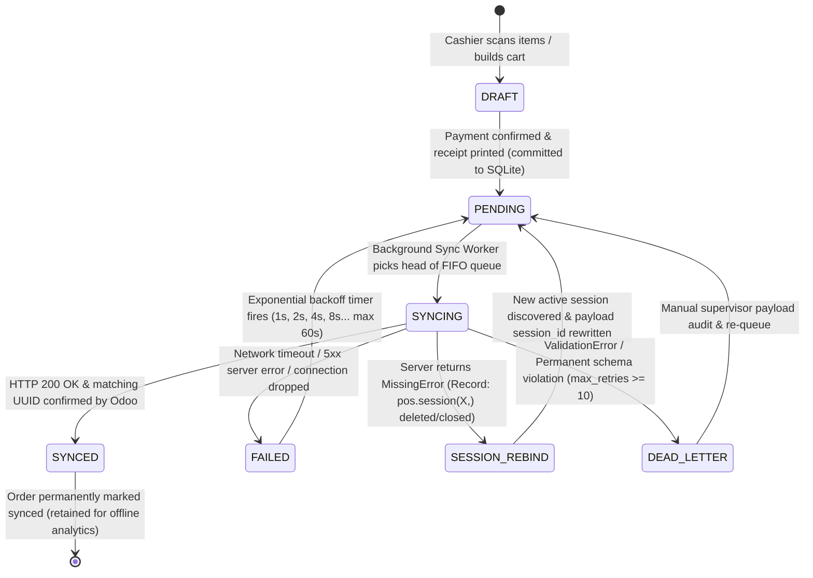
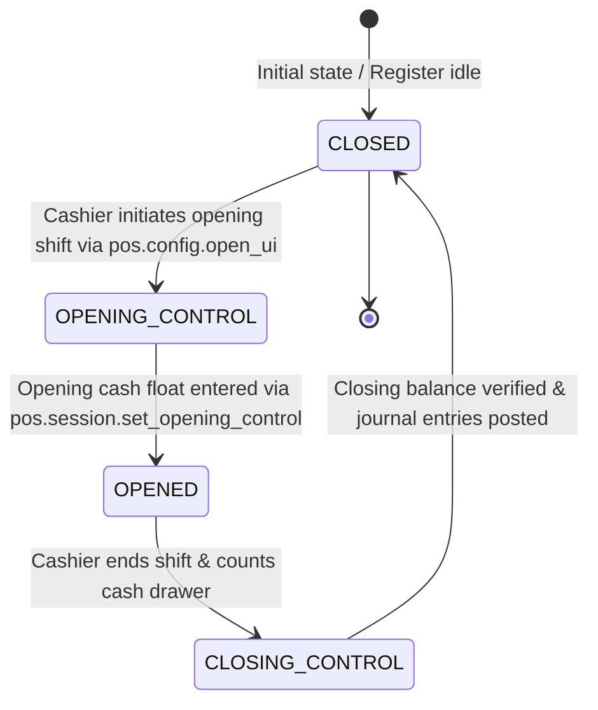
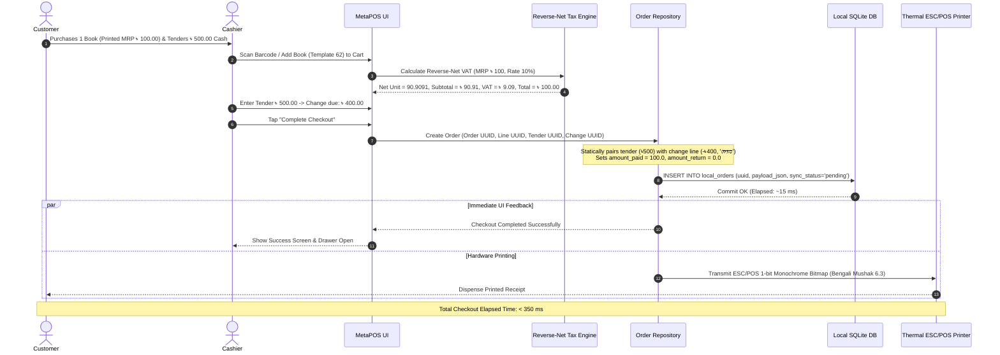
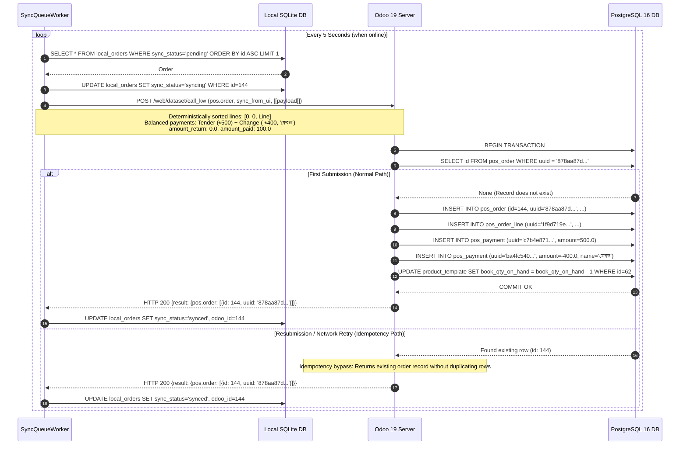
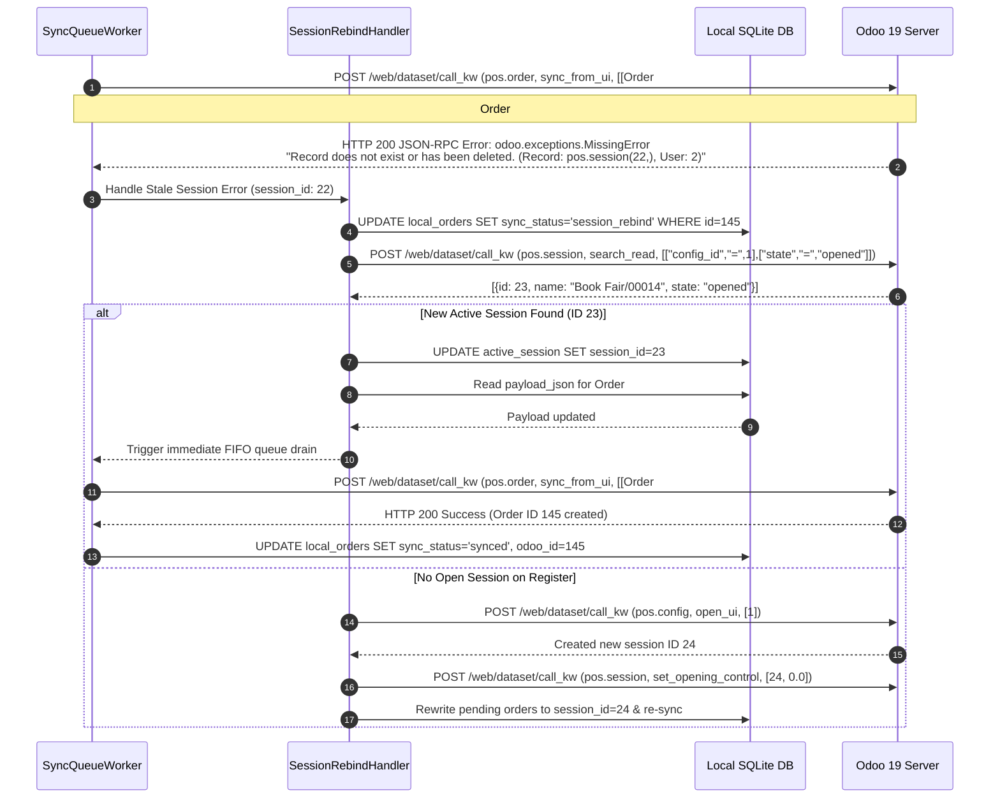

# MetaPOS: Offline Synchronization Protocol & State Machine Specifications

**Document Version:** 1.0.0  
**Target Backend:** Odoo 19.0 Community Edition (`pos.order`, `pos.session`, `pos.config`)  
**Specification Scope:** Offline Queue Persistence, Idempotency, Session Re-Binding & FIFO Replay  

---

## 1. Protocol Overview

At high-traffic retail venues, network connectivity is volatile: cellular networks experience congestion, Wi-Fi access points disconnect, and remote servers experience temporary latency spikes. MetaPOS implements an **Offline-First Zero-Data-Loss Architecture**:

1. **Instant Offline Checkout**: All checkout transactions are completed, validated, committed to local SQLite storage, and printed on the thermal receipt printer in $<500\text{ ms}$, entirely independent of network availability.
2. **Deterministic FIFO Queue Replay**: Outbound orders are enqueued in SQLite table `local_orders` and processed in strict creation order ($FIFO$) by a background synchronization engine.
3. **Multi-Level RFC 4122 v4 UUID Idempotency**: Unique UUIDs are stamped on the Order, each Order Line, and each Payment Line. Network retries never duplicate transactions.
4. **Automated Session Re-Binding**: If an order was captured under a POS session that is subsequently closed on the server before synchronization, MetaPOS intercepts the error, identifies the active session, updates the queue payload, and re-submits without operator intervention.

---

## 2. State Machines

### 2.1 Offline Order Queue State Machine

Every order transitions through a deterministic series of states managed within the local SQLite storage (`local_orders.sync_status`).



#### State Definitions & Transition Triggers:
- **`DRAFT`**: Order is actively modified in memory. Local stock reservations may be held.
- **`PENDING`**: Cashier presses "Complete Order". Order payload is written to `local_orders` with status `'pending'`. ESC/POS receipt prints immediately.
- **`SYNCING`**: Sync worker acquires queue lock, changes status to `'syncing'`, and dispatches `pos.order.sync_from_ui` JSON-RPC request.
- **`SYNCED`**: Odoo returns success (`id` and matching `uuid`). Status updated to `'synced'`, `odoo_id` recorded, and local on-hand stock count permanently decremented.
- **`FAILED`**: Network error (e.g. `SocketException`, `TimeoutException`, HTTP 502/504). Retry counter incremented; order returns to `PENDING` after exponential backoff.
- **`SESSION_REBIND`**: Server rejects order with `odoo.exceptions.MissingError` because the session was closed remotely. The automated re-binding protocol runs.
- **`DEAD_LETTER`**: Order failed 10+ times due to fatal validation errors (e.g. malformed data). Requires manual inspection via supervisor dashboard.

---

### 2.2 POS Register Session Lifecycle State Machine

Odoo 19 POS registers (`pos.config`) enforce a strict session lifecycle (`pos.session`). Orders can only be synchronized when the target session is in state `'opened'`.



#### Session Synchronization Rule:
If MetaPOS attempts to submit an order targeting a session that is in `'closing_control'` or `'closed'`, Odoo rejects the submission with `MissingError`. MetaPOS must either wait for the new session to open or query the newly opened replacement session.

---

## 3. Sequence Diagrams

### 3.1 Bootstrapping & Register Discovery

Workflow executed when a cashier logs into MetaPOS, captures the session cookie, discovers the register configuration, and caches the catalog.

```mermaid
sequenceDiagram
    autonumber
    actor Cashier
    participant App as MetaPOS Client
    participant SQLite as Local SQLite DB
    participant Odoo as Odoo 19 Server (https://demostore.metaposbd.com)

    Cashier->>App: Enter Credentials (db: demostore, user: admin)
    App->>Odoo: POST /web/session/authenticate
    Note over App,Odoo: Payload: {db, login, password}
    Odoo-->>App: Set-Cookie: session_id=r_xr...; UID=2, Currency=55 (BDT)
    App->>SQLite: Persist session cookie & user context

    App->>Odoo: POST /web/dataset/call_kw (pos.config, search_read)
    Odoo-->>App: [{id: 1, name: "Book Fair", current_session_state: "opened"}]
    
    App->>Odoo: POST /web/dataset/call_kw (pos.session, search_read, [["state","=","opened"]])
    Odoo-->>App: [{id: 23, name: "Book Fair/00014", config_id: [1, "Book Fair"]}]
    App->>SQLite: Save active_session_id = 23

    par Catalog & Category Fetch
        App->>Odoo: POST /web/dataset/call_kw (product.product, search_read)
        Odoo-->>App: 128 Products (81 books with ISBN, Author, Base64 image)
        App->>SQLite: Upsert into local_products
    and Category Hierarchy
        App->>Odoo: POST /web/dataset/call_kw (pos.category, search_read)
        Odoo-->>App: 23 Categories (including Bengali Unicode)
        App->>SQLite: Upsert into local_categories
    end

    App-->>Cashier: Display Catalog Screen (Ready for Offline Checkout)
```

---

### 3.2 High-Speed Offline Checkout (<500 ms)

Execution path when processing a customer purchase with cash over-tender and receipt printing, operating 100% locally.



---

### 3.3 Asynchronous FIFO Queue Replay & Idempotency

Background process that syncs pending orders to Odoo when connectivity is available.



---

### 3.4 Expired Session Detection & Automated Re-binding

Workflow when an order captured during offline operation references an expired or closed session.



---

## 4. Idempotency & UUID Generation Architecture

### 4.1 Multi-Level RFC 4122 v4 UUID Hierarchy

Every synchronized transaction consists of a three-tier tree of universally unique identifiers:

```
[Order Level] pos.order.uuid
     ├── [Line 1] pos.order.line.uuid (Product 44)
     ├── [Line 2] pos.order.line.uuid (Product 62)
     ├── [Payment 1] pos.payment.uuid (Tender ৳500.0)
     └── [Payment 2] pos.payment.uuid (Change -৳390.0, 'ফেরত')
```

1. **`pos.order.uuid`**:
   - Stamped by the client at transaction initialization.
   - Enforces transaction-level deduplication.
   - Database constraint: `pos_order_unique_uuid`.
2. **`pos.order.line.uuid`**:
   - Every individual line item MUST generate its own distinct RFC 4122 v4 UUID.
   - **CRITICAL**: Reusing line UUIDs across separate orders OR within the same order causes immediate database failure: `psycopg2.errors.UniqueViolation: duplicate key value violates unique constraint "pos_order_line_unique_uuid"`.
3. **`pos.payment.uuid`**:
   - Generated independently for both the tender line and the balancing change line.

---

### 4.2 Concurrency Race Resolution

If two client worker threads accidentally submit the same order payload concurrently (e.g. during a network stutter):
- Thread A reaches PostgreSQL first: inserts row and commits.
- Thread B reaches PostgreSQL seconds later: PostgreSQL triggers `UniqueViolation` on `pos_order_unique_uuid`.
- Odoo 19 wraps this as:
  ```
  odoo.exceptions.ValidationError: The operation cannot be completed: এই uuid-এর একটি অর্ডার আগে থেকেই আছে
  ```
- **Client Handling**: The MetaPOS queue worker catches `ValidationError` with message containing `uuid` and queries Odoo `pos.order.search_read([["uuid", "=", order.uuid]])`. Finding the confirmed order, it marks the local order as `'synced'` with zero error alerts, treating the race condition as an idempotent success.
